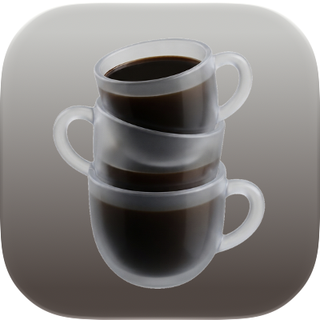

<p align="center"></p>
<div align="center"><b>Caffeinate Doubleshot</b>. Keeps a MacBook awake with the lid closed.</div>
<div align="center">Works with any <code>caffeinate</code> process, for example from Raycast or the Terminal.</div>
<div align="center">No external display or power needed.</div>

<br>
<br>

## Install

```
curl -fsSL https://github.com/floschu/caffeinate-doubleshot/releases/latest/download/install.sh | sudo bash
```

Caffeinate Doubleshot needs a MacBook and an admin account. It installs a LaunchDaemon that starts at every boot and the `doubleshot` command, with tab completion in zsh.

## Usage

Start `caffeinate` as usual, for example from Raycast or the Terminal, then close the lid. The daemon checks for `caffeinate` every 3 seconds and toggles `pmset -a disablesleep`. When `caffeinate` ends with the lid closed, the Mac sleeps right away.

```
doubleshot              # shows the current state
doubleshot disable      # turns it off and restores normal sleep, also after a reboot
doubleshot enable       # turns it back on
doubleshot battery 25   # on battery below 25%, allow sleep again (default 15, 0 = off)
doubleshot log          # shows the last 20 log lines
doubleshot update       # installs the latest release
doubleshot update 1.1.0 # installs the given release, also an older one
doubleshot version      # shows the installed version
doubleshot uninstall    # removes everything and restores normal sleep
```

With the lid closed the Mac keeps running and can get hot. Watch its temperature.

## Release

```
git tag -a v1.1.0 -m v1.1.0 && git push origin v1.1.0
```

The tag runs the tests on a macOS runner, sets the version in the scripts and creates the GitHub release with them.

## Author

Visit my [website](https://flosch.at/).
